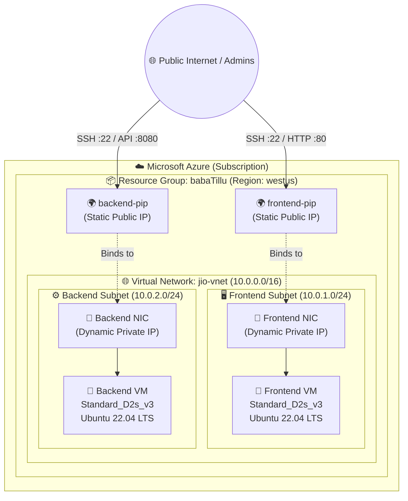
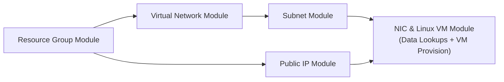

<div align="center">

# ☁️ Azure Multi-Tier Infrastructure as Code (Terraform)
### *Enterprise-Grade, Modular, & Automated Cloud Infrastructure on Microsoft Azure*

---

[](https://www.terraform.io/)
[](https://registry.terraform.io/providers/hashicorp/azurerm/latest)
[](https://releases.ubuntu.com/jammy/)
[](https://github.com/gitleaks/gitleaks)
[](LICENSE)

<br/>

<p align="center">
  <b>Production-ready Terraform codebase deploying a decoupled 2-Tier Architecture (Frontend & Backend) on Microsoft Azure.</b>
  <br/>
  Features reusable child modules, automated dependency management, dynamic data source binding, and DevSecOps secret scanning.
</p>

[Architecture](#-system-architecture) • [Project Highlights](#-key-features) • [Directory Tree](#-project-structure) • [Modules](#-modular-components) • [Getting Started](#-quickstart-guide) • [Security](#-devsecops--security)

---

</div>

## 🌟 Key Features

- 🧩 **100% Modular Design**: Independent and reusable modules for Resource Groups, Virtual Networks, Subnets, Public IPs, and Network Interfaces / Virtual Machines.
- 🔁 **Dynamic Resource Scaling**: Configured using `for_each` loops driven by structured map variables for multi-instance provisioning without code duplication.
- 🔗 **Intelligent Data Binding**: Decoupled VM provisioning where Network Interfaces dynamically fetch Subnet and Public IP IDs using Terraform `data` sources.
- 🛡️ **Network Tiering & Isolation**: Segregated subnets for Frontend (`10.0.1.0/24`) and Backend (`10.0.2.0/24`) inside a dedicated `10.0.0.0/16` Virtual Network.
- 🌐 **Static External Connectivity**: Dedicated static Azure Public IPs for direct SSH administration and web traffic routing.
- 🔍 **DevSecOps Secret Scanning**: Integrated vulnerability and token detection with **Gitleaks** (`report.json`).

---

## 📐 System Architecture

### High-Level Cloud Topology



---

### Terraform Execution & Dependency Graph



---

## 📂 Project Structure

```bash
devops-project-vm/
│
├── .gitignore                         # Excludes state files, local providers, and sensitive *.tfvars
├── README.md                          # Comprehensive project documentation
│
├── modules/                           # Reusable Terraform Child Modules
│   ├── azurerm_resource_group/        # Azure Resource Group provisioning
│   │   └── main.tf
│   ├── azurerm_virtual_network/       # Azure Virtual Network (VNet) provisioning
│   │   └── main.tf
│   ├── azurerm_subnet/                # Subnet provisioning & address prefixes
│   │   └── main.tf
│   ├── azurerm_public_ip/             # Static Public IP allocation
│   │   └── main.tf
│   └── azurerm_nic/                   # Network Interface & Linux Virtual Machine
│       ├── data.tf                    # Dynamic Subnet & Public IP data lookups
│       └── main.tf                    # NIC creation & azurerm_linux_virtual_machine
│
└── environment/                       # Target Environments
    └── preprod/                       # Pre-Production Environment Orchestration
        ├── provider.tf                # HashiCorp AzureRM provider configuration
        ├── variable.tf                # Environment variable contracts
        ├── main.tf                    # Root orchestration and module dependencies
        ├── terraform.tfvars.example   # Sanitized example configuration file
        ├── secret.txt                 # Demo test artifact for secret scanning audits
        └── report.json                # Gitleaks automated security scan report
```

---

## 📦 Modular Components

| Module Name | Path | Inputs | Resources Created |
| :--- | :--- | :--- | :--- |
| **`azurerm_resource_group`** | `modules/azurerm_resource_group` | `var.rgs` | `azurerm_resource_group` |
| **`azurerm_virtual_network`** | `modules/azurerm_virtual_network` | `var.vnets` | `azurerm_virtual_network` |
| **`azurerm_subnet`** | `modules/azurerm_subnet` | `var.subnet` | `azurerm_subnet` |
| **`azurerm_public_ip`** | `modules/azurerm_public_ip` | `var.pip` | `azurerm_public_ip` |
| **`azurerm_nic`** | `modules/azurerm_nic` | `var.vms` | `azurerm_network_interface`, `azurerm_linux_virtual_machine` |

---

## ⚙️ Resource Specifications & Inventory

The pre-production deployment (`environment/preprod`) defines the following infrastructure footprint:

### 1. Compute Instances
| Instance Name | VM Size | OS Image | Tier | Attached NIC | Attached PIP |
| :--- | :--- | :--- | :--- | :--- | :--- |
| **`frontend-vm`** | `Standard_D2s_v3` (2 vCPU, 8 GB RAM) | Ubuntu 22.04 LTS Jammy | Presentation / UI | `frontend-nic` | `frontend-pip` |
| **`backend-vm`** | `Standard_D2s_v3` (2 vCPU, 8 GB RAM) | Ubuntu 22.04 LTS Jammy | Application / API | `backend-nic` | `backend-pip` |

### 2. Networking Topology
| Subnet Name | Address Prefix | Virtual Network | CIDR Block | Usage |
| :--- | :--- | :--- | :--- | :--- |
| **`front-end-subnet`** | `10.0.1.0/24` | `jio-vnet` | `10.0.0.0/16` | Web servers, reverse proxy, ingress |
| **`back-end-subnet`** | `10.0.2.0/24` | `jio-vnet` | `10.0.0.0/16` | App services, databases, internal jobs |

---

## 🚀 Quickstart Guide

### 📋 Prerequisites

Before deploying, ensure you have:
1. **[Terraform CLI](https://developer.hashicorp.com/terraform/downloads)** `v1.0.0+`
2. **[Azure CLI](https://learn.microsoft.com/en-us/cli/azure/install-azure-cli)** (`az`)
3. An active **Azure Subscription**

```bash
# Verify installations
terraform -version
az --version

# Authenticate with Microsoft Azure
az login
az account set --subscription "<YOUR_SUBSCRIPTION_ID>"
```

---

### 🛠️ Step-by-Step Deployment

#### 1. Clone the Repository
```bash
git clone https://github.com/keshrivikash887-bit/devops-project-vm.git
cd devops-project-vm
```

#### 2. Configure Environment Variables
Navigate to the `preprod` environment and create your `terraform.tfvars`:
```bash
cd environment/preprod
cp terraform.tfvars.example terraform.tfvars
```

<details>
<summary><b>👁️ Click to inspect sample <code>terraform.tfvars</code></b></summary>

```hcl
resource_grp = {
  rg1 = {
    name     = "babaTillu"
    location = "westus"
  }
}

virtual_net = {
  vnet1 = {
    name                = "jio-vnet"
    location            = "westus"
    resource_group_name = "babaTillu"
    address_space       = ["10.0.0.0/16"]
  }
}

sub_nets = {
  subnet1 = {
    name                 = "front-end-subnet"
    resource_group_name  = "babaTillu"
    virtual_network_name = "jio-vnet"
    address_prefixes     = ["10.0.1.0/24"]
  }
  subnet2 = {
    name                 = "back-end-subnet"
    resource_group_name  = "babaTillu"
    virtual_network_name = "jio-vnet"
    address_prefixes     = ["10.0.2.0/24"]
  }
}

public_ip = {
  pip1 = {
    name                = "frontend-pip"
    resource_group_name = "babaTillu"
    location            = "westus"
    allocation_method   = "Static"
  }
  pip2 = {
    name                = "backend-pip"
    resource_group_name = "babaTillu"
    location            = "westus"
    allocation_method   = "Static"
  }
}

virtual_mac = {
  vm1 = {
    nic_name            = "frontend-nic"
    location            = "westus"
    resource_group_name = "babaTillu"
    subnet_name         = "front-end-subnet"
    vnet_name           = "jio-vnet"
    pip_name            = "frontend-pip"
    vm_name             = "frontend-vm"
    vm_size             = "Standard_D2s_v3"
    admin_username      = "azureuser"
    admin_password      = "YourStrongPassword#123"
  }
  vm2 = {
    nic_name            = "backend-nic"
    location            = "westus"
    resource_group_name = "babaTillu"
    subnet_name         = "back-end-subnet"
    vnet_name           = "jio-vnet"
    pip_name            = "backend-pip"
    vm_name             = "backend-vm"
    vm_size             = "Standard_D2s_v3"
    admin_username      = "azureuser"
    admin_password      = "YourStrongPassword#123"
  }
}
```
</details>

#### 3. Initialize Terraform
Installs the required providers (`hashicorp/azurerm` v5.7.0) and registers local child modules:
```bash
terraform init
```

#### 4. Validate & Format
```bash
terraform fmt -recursive
terraform validate
```

#### 5. Generate Execution Plan
```bash
terraform plan -out=tfplan
```

#### 6. Apply Infrastructure
```bash
terraform apply tfplan
```

---

## 🔑 Accessing Provisioned Virtual Machines

Once provisioning finishes, query the deployed Public IPs:

```bash
az network public-ip list \
  --resource-group "babaTillu" \
  --query "[].{Name:name, IPAddress:ipAddress}" \
  --output table
```

Connect using SSH:

```bash
# SSH into Frontend VM
ssh azureuser@<FRONTEND_PUBLIC_IP>

# SSH into Backend VM
ssh azureuser@<BACKEND_PUBLIC_IP>
```

---

## 🛡️ DevSecOps & Security

This repository integrates DevSecOps principles to safeguard infrastructure configurations:

- 🔒 **Automated Secret Auditing**: Scanned using **Gitleaks** to catch exposed tokens, keys, and passwords before pushing to remotes (see [`report.json`](environment/preprod/report.json)).
- 🚫 **Strict Gitignore Rules**: `.tfvars`, `terraform.tfstate`, `.terraform/`, and crash logs are ignored by default.
- 🔑 **Credential Safety**:
  > [!IMPORTANT]
  > Never commit plaintext passwords to version control. For production workloads, configure SSH Public Key authentication (`admin_ssh_key`) and retrieve credentials via Azure Key Vault.

To run a local secret audit using Gitleaks:
```bash
# Run gitleaks scan on entire git history
gitleaks detect --source . --report-format json --report-path environment/preprod/report.json -v
```

---

## 🧹 Infrastructure Teardown

To avoid unnecessary cloud billing when you are finished testing:

```bash
cd environment/preprod
terraform destroy -auto-approve
```

---

## 👨‍💻 Author & Acknowledgements

<div align="center">

**Vikash Kumar**  
*DevOps & Cloud Infrastructure Enthusiast*  
[](https://github.com/keshrivikash887-bit)

Contributions, issues, and feature requests are welcome!  
⭐️ If you found this project helpful, please give it a star on GitHub!

</div>
